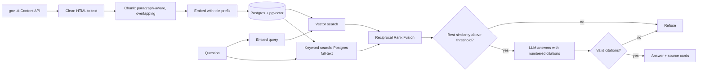

# Renters RAG: cited answers to UK renting questions

A retrieval-augmented generation (RAG) app that answers renting questions **only from gov.uk guidance**, cites the exact passage behind every claim, and **refuses** when the guidance doesn't cover the question.

> General information, not legal advice. Rules differ across the UK nations and change over time; every answer links to the page it came from, with its last-updated date.

**Live demo:** _add your URL_  |  **Eval results:** see [Results](#results)

## How it works



| Layer | Choice |
|---|---|
| API | FastAPI, rate limited, with a daily request cap |
| Retrieval | pgvector (HNSW, cosine) + Postgres full-text, fused with RRF; optional cross-encoder reranker |
| LLM | OpenAI API, JSON output, `temperature=0` |
| UI | React (Vite); citation markers highlight the matching source |
| Ops | Docker (multi-stage), docker-compose, GitHub Actions CI |

## Design decisions

- **Hybrid search.** Vector search handles paraphrases ("get my money back" vs "deposit return"); keyword search catches exact terms like scheme names. RRF merges the two rankings without having to normalise their scores.
- **Two refusal gates.** (1) If the closest chunk's cosine similarity is below `MIN_VECTOR_SCORE`, the question is off-topic and no LLM call is made. (2) If the model's answer has no valid `[n]` citation, it is replaced by a refusal. Invalid citation numbers are stripped.
- **Title-prefixed embeddings.** Each chunk is embedded with its page title so short chunks keep their context.
- **Prompt-injection hygiene.** Sources are labelled untrusted in the prompt, and the eval set includes an injection attempt.
- **Freshness.** Each chunk stores the page's `public_updated_at`, shown next to every citation.
- **Cost protection.** Per-IP rate limit and a global daily cap, since a public demo spends your API credit.

## Run it locally

```bash
cp .env.example .env            # add your OPENAI_API_KEY
docker compose up -d db         # Postgres with pgvector

python -m venv .venv && source .venv/bin/activate
pip install -r requirements-dev.txt

python -m app.ingest --dry-run  # check what will be fetched, no API calls
python -m app.ingest            # fetch, chunk, embed, store
uvicorn app.main:app --reload   # API on :8000

cd frontend && npm install && npm run dev   # UI on :5173
```

Everything in Docker (serves the built UI from the API on :8000):

```bash
docker compose up --build -d
docker compose exec api python -m app.ingest
```

Tests: `python -m pytest -q`

## Evaluation

1. Open `eval/questions.jsonl`. Read the ingested pages, then grow it to **30-50 questions**: mostly answerable ones (set `expected_url_contains` to part of the page URL that holds the answer, optionally `must_mention` keywords), plus unanswerable and out-of-corpus ones (`"answerable": false`).
2. Run:

```bash
python -m eval.run_eval              # hit@k and MRR for vector / keyword / hybrid
python -m eval.run_eval --generate   # + refusal accuracy and LLM-judged faithfulness
```

3. Run experiments, changing one thing at a time, and record each in the table below:
   - Chunk size: `CHUNK_WORDS=120`, `200`, `350`, re-run `python -m app.ingest`, then the eval.
   - Retrieval mode: the retrieval table already compares vector, keyword and hybrid.
   - Reranking: `pip install -r requirements-rerank.txt`, set `USE_RERANKER=true`, re-run.
   - Refusal threshold: vary `MIN_VECTOR_SCORE` and watch refusal accuracy.

### Results

Measured on 42 questions (30 answerable, 12 off-topic) over 29 gov.uk pages (63 chunks of about 200 words). hit@5 means a correct page appears in the top 5 retrieved chunks. MRR is the average of 1 / rank of the first correct page.

| Setup | hit@5 | MRR | Notes |
|---|---|---|---|
| vector only | 1.00 (30/30) | 0.857 | Best on this question set |
| keyword only | 0.77 (23/30) | 0.463 | Struggles when questions use everyday wording |
| hybrid (RRF, equal weights) | 0.93 (28/30) | 0.826 | Missed 2 questions that vector search found |

Hybrid search did not beat vector-only search on this data. The corpus is small and the questions are informal, so exact-word matching adds noise to the ranking. Hybrid may still help on a larger corpus or on queries with exact terms, but I haven't tested that.

| Chunk size (words) | hit@5 (hybrid) |
|---|---|
| 120 | not run yet |
| 200 | 0.93 |
| 350 | not run yet |

Generation (refusal accuracy and faithfulness): not measured yet.

**Limits of this evaluation:** 30 answerable questions is a small sample, where one question moves hit@5 by 3.3 points. Hits are counted at page level, not passage level. The questions were drafted with AI assistance and mapped to pages by page title, then [checked by me against the pages].

## Deploying

The Docker image serves both the API and the UI on `$PORT`. Use any host that runs containers (Render, Fly.io, Railway, AWS App Runner) and a managed Postgres that supports `pgvector` (for example Neon or Supabase; check the provider's docs). Set `OPENAI_API_KEY` and `DATABASE_URL` as secrets, run `python -m app.ingest` once against that database, and keep `RATE_LIMIT_PER_MINUTE` / `DAILY_REQUEST_CAP` low.

## Limitations and next steps

- In-memory rate limiting only works for a single instance; use Redis for several.
- A new database connection is opened per request; add a connection pool for real traffic.
- Content is England-focused gov.uk guidance; it is not jurisdiction-aware.
- Next: streaming responses, a re-ingest schedule to track page updates, conversation memory, and tool calling (for example a tool that calculates deposit deadlines).

Contains public sector information licensed under the [Open Government Licence v3.0](https://www.nationalarchives.gov.uk/doc/open-government-licence/version/3.0/).


#Terminal 1
cd ~/Downloads/renters-rag
source .venv/bin/activate
docker compose up -d db

python -c "from app.config import settings; print(settings.chat_model)"

uvicorn app.main:app --reload

 # Terminal 2
cd ~/Downloads/renters-rag/frontend
npm run dev 